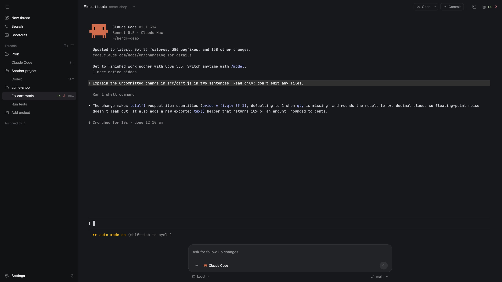
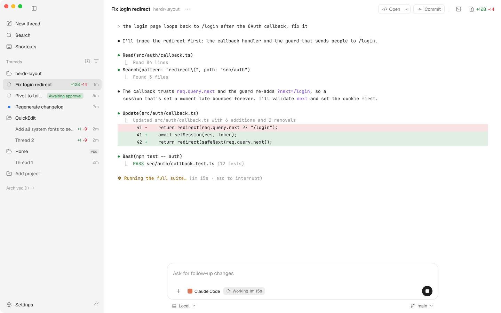
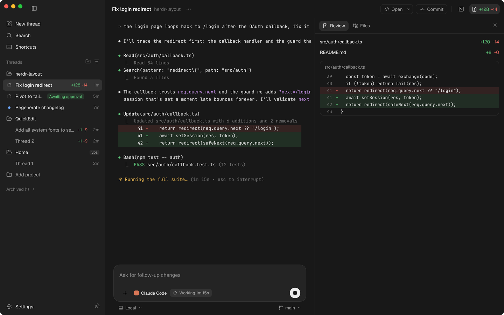

# Herdr layouts by Keyur Amin

Layouts for [Herdr](https://herdr.dev), the desktop app for terminals and
coding agents. Each folder is one layout, laid out the way
[herdr.dev/layouts](https://herdr.dev/layouts/) expects: `layouts/`, `mods/`,
a `RECIPE.md` and a `preview.png`.

## Studio

A desktop-agent-app look for Herdr. It has a projects-and-threads sidebar
with live status (working, awaiting approval, done) and per-thread git diffs.
The center shows the thread's live terminal. Under it is a rounded composer
that sends follow-ups to the agent, with Stop while it works, and on macOS a
mic so you can talk to it. The header has
Open (in your editor), Commit and a diff counter that opens the review
panel. Light and dark themes switch from the sidebar.



| Light | Review panel |
|---|---|
|  |  |

All three pictures are real captures from Herdr 0.1.9 on macOS. They show a
small demo project.

### Add it

Tell your agent:

```
Read ~/.config/herdr-app/AGENTS.md, then add this layout: github.com/keyuramins/herdr-layout/tree/main/studio
```

Once herdr.dev lists it, `herdr.dev/layouts/keyuramins/studio` works too.
Your own layout stays as it was. `ctrl-shift-l` switches between layouts.

Merge `studio/keys.json` into your keys for the shortcuts:

| Shortcut (macOS / Linux, Windows) | What it does |
|---|---|
| `cmd-j` / `ctrl-shift-j` | Toggle the terminal |
| `cmd-shift-r` / `ctrl-shift-r` | Toggle the review panel |
| `cmd-shift-m` / `ctrl-shift-m` | Start or stop the mic (macOS) |

The two themes ship inside the mod. On first start the mod copies them into
`~/.config/herdr-app/themes/`, and it never overwrites a theme you edited.

### What it touches

These are things the mod does beyond drawing:

- Runs `git diff --numstat HEAD` and `git rev-parse` in your threads'
  folders, every few seconds.
- Runs `hc send` and `hc interrupt` when you use the composer.
- Opens your editor or file manager, only when you click Open.
- Writes `appearance` in `settings.json`, only when you click the theme
  switch.
- Writes `themes/studio-light.json` and `themes/studio-dark.json` on first
  start, if they're missing.
- **The mic (macOS, only when you click it):** the first click builds a small
  helper app, Studio Dictation, from `mods/studio/dictation/main.swift` with
  your Mac's Swift compiler (`xcrun swiftc`). It's built into
  `mods/studio/.build/`. The helper picks the newest speech engine the Mac
  has. On macOS 26 and later that's Apple's on-device transcriber, the one
  behind the latest Dictation; it downloads its language model once if it's
  missing. Older Macs use Apple's older recognizer, which may send audio to
  Apple's speech service, as Dictation does. macOS asks once for the
  microphone (and, for the older engine, speech recognition). Studio itself
  only reads the text.

Studio itself makes no network calls.

## Credits

Icons are from [Lucide](https://lucide.dev) (ISC, see
`studio/mods/studio/icons/LICENSE-lucide`). Built on Herdr's mod API and
its shipped `changes`, `files`, `new-menu`, `menu`, `picker` and `worktree`
mods.

## Author

Made by [Keyur Amin](https://github.com/keyuramins) ([keyuramin.com](https://keyuramin.com)).

## License

MIT
