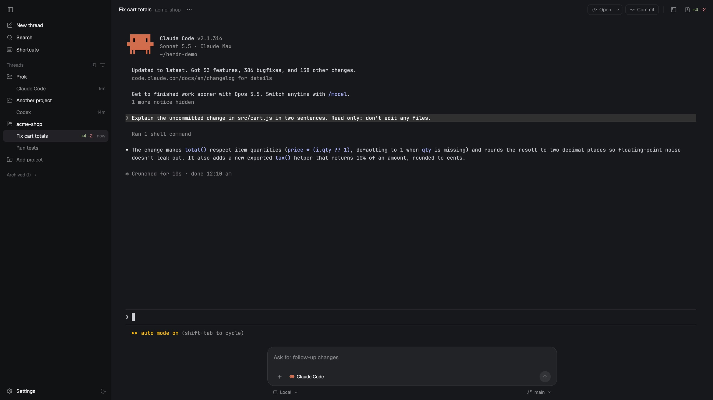

# Studio

Studio dresses Herdr as a desktop agent app. A quiet sidebar lists every
project with its threads. Each thread shows a spinner while its agent works,
an "Awaiting approval" pill when the agent needs you, and a blue dot when it
finished while you looked away. The thread fills the middle with its live
terminal. Under it sits a rounded composer that sends follow-ups to the
agent, and a review panel on the right opens on the diff. Studio has a light
theme and a dark theme, and a switch in the sidebar cycles System, Light and
Dark.

## What you see

Left to right, at zoom 1:

- **Sidebar** (300px, 220–440 drag, `chrome`: `#1f1f1f` dark, `#f4f4f4` light).
  - **Top strip** (52px, drags the window): room for the macOS traffic lights
    (84px) and a fold button (`panel-left`, 16px).
  - **Nav**: New thread (`square-pen`), Search (`search`) and Shortcuts
    (`keyboard`). Rows are 32px tall with 13.5px text, 8px radius and a
    `hover` background.
  - **Pinned threads**, shown only when something is pinned.
  - **Threads** header (12.5px, `dim`), with Add project (`folder-plus`) and
    Organize (`list-filter`) on the right. Organize opens an inline card with
    By project and Chronological.
  - **By project**: one row per space (`folder` or `folder-open`, its name,
    "Home" for `~`, and a machine badge for remote spaces). Its threads sit
    under it, one per tab. A thread row has a 16px status slot, then the
    title (`muted`; `foreground` and medium weight when it is open or needs
    you), then the green/red diff `+N -M` (12px, `ansi2`/`ansi1`), then the
    age (`now`, `5m`, `2h`, `3d`). The open thread gets the `selected`
    background.
  - **Chronological**: every open thread newest first, each with its
    project name.
  - **Add project** row, then **Archived (n)**, a folded list of settled tabs.
  - **Footer** (48px): Settings, and a theme switch (`sun-moon`, `sun` or
    `moon`).
- **Work column** (`background`: `#181818` dark, `#ffffff` light).
  - **Header** (52px, drags the window). On the left: the thread title (14px
    semibold), the project (13.5px `dim`), and `···`. On the right: a split
    **Open** button (`code-xml` "Open" plus a chevron, 28px, 1px `border`,
    8px radius), **Commit** (`git-commit-horizontal`), a 1×18 divider, the
    terminal toggle (`square-terminal`) and the diff counter (`file-diff`
    `+N -M`). On Linux and Windows, the window buttons come last.
  - **Thread**: the active tab's live terminals with terminal padding
    `[28, 14]` and 10px side padding. A lone pane has no frame. Split panes
    become cards with 10px radius, a `border` outline and `input` on focus.
  - **Composer** (176px). A box up to 780px wide, centered, with 18px radius,
    `popover` background and a 1px `border` (`input` when focused). Inside:
    a multi-line, wrapping text box with the placeholder "Ask for follow-up
    changes" (14.5px, about three lines before it scrolls), then
    a row with `+`, the agent chip (program icon and name), a status pill,
    on macOS a 30px mic (`mic`, `muted`; red on a 16% tint, gently pulsing,
    while listening), and a 30px round button: send (`arrow-up`, `solid`
    when there is text) or stop (a square) while the agent works. Under the box: Local or
    Worktree (`laptop` or `git-fork`), a machine chip for remote threads,
    and on the right the branch (`git-branch`).
- **Review panel** (hidden at first; 540px, 340–1100, behind a 1px `border`
  divider). Its head (44px) has Review (`file-diff`) and Files
  (`folder-tree`) tabs and a close button. Below the head is a stack of
  Herdr's own `changes` panel (the diff, stage or revert, and the commit
  box) and its `files` tree.

The colors are two theme files, `studio-dark` and `studio-light`. The status
colors are working (gray `#a3a3a3` or `#8a8a8a`), blocked (green `#5fc77a` or
`#1a7f37`, the "Awaiting approval" pill on a 14% tint) and done (blue
`#6ea8fe` or `#2f7af5`). The icons are Lucide at a 1.6 stroke.

## How it behaves

- **working**: a spinning ring (`spinner.svg`, `.spin(900)`) in the thread's
  slot. The composer shows "Working 1m 15s", ticking each second, and its
  button becomes Stop (`hc interrupt <agent>`).
- **blocked**: a still gray ring and a green "Awaiting approval" pill, which
  hides the diff and project label. The title stays bright.
- **done**: a blue 7px dot and a bright title. Herdr turns it idle once you
  look.
- **idle**: an empty slot and a muted title.
- **Clicks on the sidebar:**
  - A thread selects its tab (`tab.select`). An archived thread unsettles it.
    Right-click opens Herdr's tab menu (`menu`, `{tab: "tab"}`).
  - Hovering a thread swaps the diff and age for Pin and Archive
    (`tab.settle`). Pins are this layout's own (shared `studio.pins`).
  - A project row folds and unfolds (shared `studio.collapsed`). On hover it
    shows `···` (the space menu) and New thread. Right-click opens the space
    menu.
  - New thread opens Herdr's `new-menu` popup (terminal, installed agents,
    new space or worktree). Search runs `mod.open picker`. Shortcuts runs
    `app.help`. Settings runs `app.settings`.
  - Add project opens the system folder picker, then `space.new {folder}`.
  - The theme switch cycles System, Light, Dark. It writes only
    `appearance` in `settings.json` (removing it for System), and Herdr
    shows `studio-light` or `studio-dark` from the layout's theme pair.
- **The header:**
  - Open runs the last-picked target on the thread's folder. On macOS that
    is `open -a "Visual Studio Code" | Cursor | Zed | Terminal`, or `open`
    for Finder. Linux uses `code`, `cursor`, `zed` or `xdg-open`. Windows
    uses `code` or `cursor` through `cmd /c`, or `explorer.exe`. The chevron
    picks another (shared `studio.editor`). A failure posts a toast. Remote
    threads only get a toast.
  - Commit selects `changes` in `review-body` and shows `review`.
  - The diff counter toggles the review panel. The terminal toggle splits a
    shell under the agent the first time, then zooms the agent to hide or
    show it.
- **The composer:** Shift+Enter starts a new line. Enter or the send button
  runs `hc send <agent> <text>`,
  which pastes the text and presses Enter. It goes to the focused terminal's
  agent, else the thread's agent, else its first terminal. `+` opens
  `new-menu`. The agent chip runs `agent.next`. Local or Worktree opens
  Herdr's `worktree` dialog (`action: "new"`), and the branch chip opens it
  with `action: "open"`.
- **The mic** (macOS only; hidden elsewhere, and hidden when the Mac has no
  Swift compiler and no helper built yet):
  - The first click builds the helper app, Studio Dictation, from
    `dictation/main.swift` with the Mac's own `swiftc`, in the background
    (`dictation/build.sh`, about 15 seconds). The pill says "Setting up
    dictation…" and the mic spins. Later clicks start at once.
  - The helper picks the newest engine the Mac has, by itself. On macOS 26
    and later (and a macOS 26 SDK) that's `SpeechTranscriber` with
    `SpeechAnalyzer`, on-device; its language model downloads once if it's
    missing ("Getting speech model…"). Otherwise it uses `SFSpeechRecognizer`.
    Both get a list of coding words as hints. macOS asks once for the
    microphone (and speech recognition for the older engine), in the helper's
    name. The pill says "Starting mic…" until it's listening, then
    "Listening…".
  - Words appear in the box as they're recognized, after anything already
    typed. A pause of 2 seconds, a second click, or 60 seconds ends it;
    10 seconds of silence at the start ends it with nothing added. Nothing is
    sent: Enter sends, as with typing. Dictated words stay in the box: an
    empty or shorter result from the engine never clears them. Typing or
    deleting while it listens makes the box the new start: words heard
    before the edit aren't added back.
  - Stop always stops: if the helper hasn't answered 6 seconds after a stop
    (or runs past 75 seconds), Studio ends it (`pkill`) and keeps the words.
  - A refused permission, a missing microphone or a failed build posts a
    toast saying where to fix it.
- **Keys** (`keys.json`, section `layout:studio`): `cmd-j` or `ctrl-shift-j`
  toggles the terminal, `cmd-shift-r` or `ctrl-shift-r` toggles review, and
  `cmd-shift-m` or `ctrl-shift-m` starts or stops the mic.
  Herdr's `cmd-b` or `ctrl-shift-b` folds the sidebar, because the node is
  named `sidebar`.
- **Refresh rates:** the diffs refresh every 6s in the sidebar and every 4s
  in the header, one `git diff --numstat HEAD` per folder. Ages redraw twice
  a minute.

## Built from

- `layouts/studio.json`. The root is a `row` with `titlebar: "none"`,
  `traffic_lights: [18, 18]`,
  `theme: {light: "studio-light", dark: "studio-dark"}`,
  `terminal_padding: [28, 14]` and `preview: "layouts/studio.png"`. It has
  two children:
  - `sidebar`, a column of 300px:
    - `side-top`, a block of 52px with `window_drag`.
    - `side`, a block.
  - `work`, a column:
    - `head`, a block of 52px with `window_drag`.
    - `body`, a row with a 1px `border` divider:
      - `thread`, a column holding `main` (`{tab: "active"}`, frameless when
        lone) and `composer` (176px).
      - `review`, a column, hidden, 540px. It holds `review-head` (44px) and
        `review-body`, a stack with `changes` (mod `changes`) and `files`
        (mod `files`).
- **One mod, `mods/studio/`** (`place: "none"`), picked by `props().part`:
  - `side-top`, `sidebar`, `header`, `composer` and `review-head` sit in the
    layout.
  - `open-menu` is opened as a popup by the header.
  - The code is split across `main.js` (dispatch), `sidebar.js`,
    `header.js`, `composer.js`, `review.js`, `voice.js` (the mic) and
    `lib.js` (helpers, git, appearance, theme install).
  - `dictation/` holds the mic's helper: `main.swift` (AppKit, AVFoundation
    and Speech: `SFSpeechRecognizer` with an `AVAudioEngine` tap),
    `Info.plist` (an `LSUIElement` app with `NSMicrophoneUsageDescription`
    and `NSSpeechRecognitionUsageDescription`) and `build.sh`
    (`xcrun swiftc -swift-version 5 -O`, then an ad-hoc `codesign`). The new
    engine's code sits behind `#if compiler(>=6.2)` and
    `#available(macOS 26.0, *)`, so the same source builds and runs on older
    Macs with the older engine. It builds
    into `mods/studio/.build/StudioDictation.app`. Studio starts it with
    `open -g -n <app> --args <session folder>`, a new folder per session
    under `.build/sessions/`, after closing any helper still running
    (`pkill -f`). They talk through files there: the helper writes `status`, `partial.txt` and `final.txt`, and
    Studio writes `stop`. `voice.js` polls them every 250 ms while a session
    runs, and does nothing otherwise.
- **Shipped mods it uses:** `changes`, `files`, `new-menu`, `menu`, `picker`
  and `worktree`.
- **`herdr` calls:** `spaces`, `panes`, `agents`, `focused`, `layout`,
  `theme`, `window`, `shared` and `setShared`, `run`, `openOverlay` and
  `closeOverlay`, `notify`, `exec`, `hc`, `readTextFile` and
  `writeTextFile`, `appHome`, `pickFolder` and `nextCommand`.
- **Commands:** `tab.select`, `tab.settle`, `tab.unsettle`, `space.new`,
  `space.select`, `pane.split`, `pane.zoom`, `pane.focus`, `layout.show`,
  `layout.hide`, `layout.toggle`, `layout.select`, `agent.next`, `mod.open`,
  `app.help`, `app.settings` and `window.*`.
- **Programs it runs:**
  - `git` (`diff --numstat HEAD` and `rev-parse`).
  - `hc send` and `hc interrupt`.
  - The editors or file manager, only when you click Open.
- **Art:** Lucide icons in `mods/studio/icons/` (ISC, stroke 1.6, `mic`
  included) and `spinner.svg`. The two themes are in `mods/studio/themes/`.

## Watch out

- **The themes live inside the mod.** A shared layout folder carries only
  `layouts/` and `mods/`. On start, the `side-top` part copies
  `mods/studio/themes/studio-*.json` into the home's `themes/` when they're
  missing, and Herdr picks them up. Until then (the first second of the
  first run), the window shows graphite and `layout.error` mentions the
  missing theme. The copy never overwrites an existing file, so your edits
  stick.
- The theme switch changes `appearance` for the whole app, not only this
  layout, because that is where Herdr keeps light and dark.
- Diffs count tracked changes against HEAD, so new untracked files don't add
  to `+N`. When threads share a folder, only the open thread shows the
  diff, so the number isn't repeated down the list.
- Thread titles are the tab's name when someone named it. Otherwise the
  title is the terminal's title with leading symbols stripped, and when
  there's none, "Thread n".
- **Herdr can't open the microphone itself.** Its app bundle has no
  microphone usage description, and macOS refuses a process whose app
  doesn't declare one. That's why the mic goes through a separate helper
  app, started with `open` so macOS treats it as its own app (a program run
  directly by Herdr would count as Herdr). Herdr has no Edit menu either, so
  macOS's own "Start Dictation…" can't be triggered from a click.
- The helper is built on the user's Mac, not shipped as a binary, so the mic
  needs Xcode or the Command Line Tools (`xcode-select --install`). Without
  them, and without a helper already built, the mic stays hidden.
- macOS ties the permissions to the helper's signature. An ad-hoc signed
  rebuild (after `VERSION` in `voice.js` changes) may ask again.
- One `exec` may run for 30 seconds at most, so the build starts in the
  background (`nohup sh build.sh … &`), and the helper runs on its own
  (`open`, not waited for). Studio polls the files instead.
- Build output goes into a hidden `.build/` folder, because Herdr hot-reloads
  a mod whenever a file in its folder changes, except hidden ones.
- The composer is a `TextareaState` + `Textarea` (gpui-base) with soft wrap.
  A multi-line box inserts a new line on Enter before it reports "submit"
  (scripts can't turn on submit-on-enter), so plain Enter sends the text
  as it was before that new line, and Shift+Enter (`event.shift`) keeps it.
  A key handler on a wrapper can't catch Enter first, because GPUI runs the
  box's own key binding before wrapper key handlers.
- The composer doesn't report a busy agent, and it can't
  attach images.
- Open can't reach folders on other machines. The app names on macOS are
  fixed: "Visual Studio Code", "Cursor", "Zed" and "Terminal".
- Every part takes `nextCommand()` keys, but only `header` acts on them.
  The others would toggle things five times.
- `mod.json` must stay `place: "none"`, or Herdr docks a stray copy into
  other layouts.

## Done when

- Switching to `studio` shows the sidebar, header, live terminal and
  composer. After the first start, `themes/studio-light.json` and
  `themes/studio-dark.json` exist.
- Spaces show as projects and tabs as threads. A working agent spins, a
  blocked one shows "Awaiting approval", and a finished one gets a blue dot.
- Typing in the composer and pressing Enter reaches the agent. While it
  works, Stop interrupts it.
- Commit and the diff counter open the review panel on Herdr's `changes`,
  and Files switches to the tree.
- The theme switch flips light and dark at once, and System follows the OS.
- On macOS, the mic shows. Its first click builds Studio Dictation, and words
  spoken then appear in the box. It stops by itself after a pause, and
  Enter sends them. On Linux and Windows there is no mic.
- `herdr-app check mods/studio` passes. `ctrl-shift-l` switches away and
  back.
